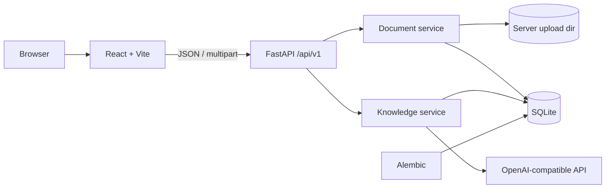

# BioLearn AI 技术架构（阶段三）

本文描述当前实际代码：学科/章节管理、资料导入解析、分块、AI 知识点提取、审核草稿和正式入库。

## 1. 系统上下文



- 前端只通过 REST API 操作数据。
- 上传文件保存到服务器 `UPLOAD_DIR`，数据库只保存元数据和相对存储名。
- 解析与 AI 提取使用 FastAPI `BackgroundTasks`，状态写入数据库，前端轮询。
- AI 输出必须通过 Pydantic 校验；来源位置由系统从 chunk 元数据注入，不信任模型给出的页码。
- AI Key 只在后端 `Settings` 中读取，不进入 API 响应、前端 bundle 或日志。

## 2. 模块边界

```text
backend/app/
  api/v1/
    subjects.py, chapters.py       # 阶段二
    imports.py                     # 智能导入、导入偏好、确认/重试
    documents.py                   # 上传、解析状态、删除、归属调整、启动 AI
    knowledge.py                   # 知识点 CRUD、审核、合并、任务、取消
    questions.py                   # 题目 CRUD、审核、批量操作、重新生成
    practice.py                    # 抽题、提交判分、人工评分、错题本
    ai.py                          # 配置状态与连接测试
  models/
    subject.py, chapter.py
    document.py                    # Document, DocumentChunk
    knowledge.py                   # KnowledgeExtractionJob, KnowledgePoint
    importing.py                   # ImportPreferences, ImportJob
    question.py                    # Question, QuestionGenerationJob, Practice*
  schemas/
    subject.py, chapter.py
    document.py, knowledge.py, ai.py, imports.py, external_import.py, question.py
  services/
    parsing.py                     # 文件签名 + 各格式解析
    chunking.py                    # 标题/页/幻灯片边界分块
    documents.py                   # 存储、去重、解析任务、删除、归属调整
    importing.py                   # 结构识别、章节匹配/建章、导入编排
    external_import.py             # 外部 AI JSON 校验、预览、知识点映射
    ai_client.py                   # OpenAI 兼容客户端、重试、取消检查
    knowledge.py                   # 分析/提取（有界并发）/合并/草稿/取消/计时
    knowledge_review.py            # 审核树、编辑、批量审核、合并
    knowledge_common.py            # 树、统计、父级校验
    questions.py                   # 题目校验、选项/答案规则、重复检测、审核
    question_generation.py         # 已审核知识点出题、任务、取消/重试
    practice.py                    # 抽题、判分、答题记录、错题
    mappers.py                     # ORM → API schema
    recovery.py                    # 重启后标记中断任务
frontend/src/
  pages/ImportPage.tsx
  pages/DocumentsPage.tsx
  pages/KnowledgeReviewPage.tsx
  pages/QuestionsPage.tsx
  pages/PracticePage.tsx
  components/DocumentUploadCard.tsx
  components/KnowledgePointTree.tsx
  components/KnowledgePointForm.tsx
  lib/api/imports.ts, documents.ts, knowledge.ts, questions.ts, practice.ts, ai.ts
```

| 模块 | 职责 | 不承担 |
| --- | --- | --- |
| `parsing` | 文件签名、格式解析、页码/幻灯片位置 | 数据库、AI |
| `chunking` | 稳定顺序、标题路径、来源范围 | 调用模型 |
| `documents` | 文件保存、哈希、状态、重试、删除、归属调整 | AI 内容生成、章节结构判断 |
| `importing` | PPT/文档结构识别、章节匹配与安全建章、导入编排 | 解析原始文件、AI 知识点提取 |
| `external_import` | 外部 AI JSON Schema 校验、预览、章节/知识点映射、重复策略 | 调用网页 AI、生成假数据 |
| `ai_client` | HTTP、鉴权、超时、有限重试、JSON 解析、取消检查 | 业务字段解释 |
| `knowledge` | 多阶段提示词、有界并发提取、计时、输出校验、合并、草稿持久化、取消 | HTTP 响应 |
| `knowledge_review` | 人工编辑、审核、合并、删除保护 | 模型调用 |
| `questions` | 题型/选项/答案校验、重复检测、题目审核 | 抽题判分 |
| `question_generation` | 只选 approved 知识点、结构化出题、任务取消/重试 | 人工审核、事实验证 |
| `practice` | approved 题库抽题、自动判分、人工评分、错题聚合 | 学习画像/自适应算法 |
| `recovery` | 启动时将中断的解析/AI/导入/出题任务标记为可重试或已停止 | 自动重新调用模型 |

## 3. 数据库模型

### Document

| 字段 | 说明 |
| --- | --- |
| `id` | UUID |
| `subject_id` | 学科，`ON DELETE CASCADE` |
| `chapter_id` | 章节，`ON DELETE SET NULL` |
| `name` / `content_title` | 用户名称 / 解析标题 |
| `original_filename` | 清理后的原始文件名 |
| `storage_name` | 服务端 UUID 文件名 |
| `mime_type` / `extension` / `size_bytes` / `sha256` | 格式与内容身份 |
| `status` | `uploaded`、`parsing`、`parsed`、`failed`、`needs_ocr` |
| `parse_error` / `parse_warnings` | 失败原因/警告 |
| `page_count` / `slide_count` | 位置统计 |
| `uploaded_at` / `parsed_at` | 时间 |

### DocumentChunk

- UUID；`document_id` 外键，`ON DELETE CASCADE`；`(document_id, chunk_index)` 唯一。
- `heading_path`、`heading_level` 保留标题结构。
- `content` 保留段落、列表、Markdown 表格；PDF/PPTX 来源块保留页码/幻灯片。
- `page_start/page_end`、`slide_number`、`char_start/char_end`、`block_start/block_end` 用于回溯。
- `location_label` 是可直接显示的“第 X 页 / 第 X 张幻灯片”。
- PDF 和 PPTX 分块不跨页/跨幻灯片；小分块也不会跨页合并。

### KnowledgeExtractionJob

- `status`: `queued`、`analyzing`、`extracting`、`merging`、`cancelling`、`cancelled`、`completed`、`failed`
- `cancel_requested`: 用户请求停止的持久化标记；运行器在模型调用前后和分块/批次边界检查
- 停止 API：`POST /knowledge-jobs/{job_id}/cancel`；停止不会保存本次新草稿
- `stage`、`progress` 0–100、`error`、`attempts`
- `total_chunks`、`processed_chunks`、`extracted_count`、`merged_count`、`duplicate_count`
- 记录 provider/model 快照，便于审计。

### KnowledgePoint

- UUID；学科/章节/资料外键；自引用 `parent_id`。
- `name`、`point_type`、`explanation`、`core_points`（JSON 数组）、`conditions`。
- `source_quote`、`source_quote_verified`、`source_page/page_end`、`source_slide`、`source_locator`、`source_chunk_id`。
- `confidence`、`review_note`、`needs_review`。
- `origin`: `ai` / `manual`。
- `review_status`: `pending` / `approved` / `needs_revision` / `ignored`。
- `duplicate_of_id`：与已审核知识点同名时的提示。
- `published_at`：审核通过时写入，表示正式入库。

### Chapter 来源字段

- `source_document_id`、`source_import_job_id`、`source_slide`：自动创建章节时记录来源资料、导入任务和幻灯片编号；用户手动章节保持为空。

### ImportPreferences

- 单行配置：默认学科/章节、默认模式（preset/auto_create/smart_archive）、自动分析、预览确认、不确定策略（confirm/use_default/create）。
- 默认学科/章节删除时置空，不阻止学科/章节删除。

### ImportJob

- `status`: `queued`、`parsing`、`detecting`、`awaiting_confirmation`、`archiving`、`analyzing`、`completed`、`failed`
- `suggestion`：章节建议 JSON（标题、来源、动作、existing path、source_slide）。
- `result`：学科/章节、创建/复用章节 ID、路径、是否重复文件。
- `analysis_job_id` / `analysis_status` / `analysis_error`：归档成功后的 AI 阶段独立记录，避免把资料归档误标为失败。
- `source_type`：`courseware` 或 `external_json`；`payload` 保存校验后的外部 JSON；`duplicate_strategy` 为 skip/update_pending。
- `timings`：导入阶段耗时（外部 JSON 校验等）。
- 重启恢复：解析/建章中断标记失败可重试；AI 阶段中断保留已归档资料并标记 AI 失败。

### 外部 AI 知识点字段

- `knowledge_points.importance`、`prerequisites`（JSON 数组）、`external_id`（外部稳定标识）。
- 外部 `key_terms` 映射到 `core_points`；`source.quote` 保存但不标记为原文核验。
- 外部 `category` 通过别名映射到现有 `KnowledgePointType`；未知类别归为基本概念并写入审核备注。

## 4. 文件安全

1. 文件名只取 basename，移除控制字符和 Windows 非法字符。
2. 存储名由服务端 UUID + 规范化扩展名生成，完全不使用用户路径。
3. 保存路径 `resolve()` 后必须位于 `UPLOAD_DIR` 内。
4. 上传过程中累计大小，超过 `MAX_UPLOAD_BYTES` 立即中止并删除临时文件。
5. 空文件拒绝。
6. 扩展名白名单 + 实际内容签名：
   - PDF 必须 `%PDF-`
   - DOCX/PPTX 必须是 ZIP，且包含对应 OpenXML 路径
   - TXT/MD 必须能按文本编码解码，且不能含 NUL
7. 旧版 `.ppt` 明确返回 `legacy_ppt_unsupported`。
8. 重复内容用 SHA-256 检测；默认 409，用户确认后 `force=true` 才允许。
9. 删除资料时先检查关联知识点和运行中任务；确认后数据库级联 + 删除磁盘文件。

## 5. 解析与分块

| 格式 | 实现 | 结构 |
| --- | --- | --- |
| PDF | `pypdf.PdfReader` 逐页 `extract_text()` | 页码、页内段落；无文本则 `needs_ocr` |
| DOCX | `python-docx` 遍历 body 的 `CT_P`/`CT_Tbl` | Heading 1–9、列表、段落、Markdown 表格 |
| PPTX | `python-pptx` 遍历 slide/shape | 幻灯片标题、文本框、表格、slide number |
| TXT | 编码尝试 + 标题/列表启发式 | 标题层级、段落、字符范围 |
| MD | 逐行解析标题/列表/表格/代码块 | 标题层级、段落、字符范围 |

分块规则：

- 标题变化时 flush。
- PDF 页码变化时 flush；PPTX 幻灯片变化时 flush。
- 单块超过 `CHUNK_MAX_CHARS` 时按段落/句号切分，再硬上限。
- 小于 `CHUNK_MIN_CHARS` 的块只在同标题、同页、同幻灯片内合并。
- 每个分块有稳定 UUID、顺序和字符范围。

## 6. AI 客户端

- `OpenAICompatibleClient` 使用：
  - `POST {AI_API_BASE}/chat/completions`
  - `GET {AI_API_BASE}/models` 连接测试
- 配置项：`AI_PROVIDER`、`AI_API_BASE`、`AI_API_KEY`、`AI_MODEL`、超时、重试次数、temperature。
- 仅 `openai`、`openai-compatible`、`custom` provider 被接受。
- 超时/网络错误/429/5xx 使用指数退避，最多 `AI_MAX_RETRIES`；401/403/404/400 不重试。
- 不把 provider error body、prompt 或文档内容写入日志；日志只记录状态码和阶段。
- AI 未配置时，启动提取返回 `503 ai_not_configured`。

## 7. 多阶段知识点流程

1. **结构分析**：分块标题路径 + 摘要构成提纲，限制 `AI_OUTLINE_MAX_CHARS`，输出 `AIDocumentAnalysis`。
2. **分块提取**：每块最多 `AI_MAX_POINTS_PER_CHUNK` 个点，输出 `AIExtractionResponse`。
3. **引文校验**：`normalize_text(quote) in normalize_text(chunk.content)`；不匹配则丢弃引文并标记待确认。
4. **分层合并**：
   - 每批最多 `AI_MERGE_BATCH_SIZE` 个候选。
   - 输出 `AIMergeResponse`；`source_point_ids` 必须存在于原提取结果。
   - 批次结果递归合并；服务端按规范化名称再去重。
   - 合并结果不允许生成新引文；来源元数据从原 `RawPoint` 映射。
5. **草稿持久化**：
   - 先保护已审核/人工知识点的子节点（必要时提升为根，避免级联误删）。
   - 删除旧的未审核 AI 草稿。
   - 插入新草稿，建立 parent 关系；检测父 ref 循环。
   - 与已审核知识点同名时写 `duplicate_of_id` 和审核备注。
6. **人工审核**：状态改变不改动原始来源；审核通过写入 `published_at`。

## 8. API 与错误

阶段三 API 见 README。错误统一：

```json
{"detail":{"code":"...","message":"...","extra":...}}
```

关键错误码：

- `unsupported_file_type` 415
- `file_too_large` 413
- `empty_file` / `file_content_mismatch` / `encrypted_pdf` 422
- `duplicate_document` 409
- `document_has_knowledge_points` 409
- `ai_not_configured` 503
- `document_not_parsed` / `job_already_running` 409
- `knowledge_point_cycle` 422
- `knowledge_point_has_children` 409
- `ai_connection_failed` 502

## 9. 前端

- `/subjects/{subjectId}/documents`：资料上传、列表、状态轮询、解析结果模态、重试、AI 启动、删除确认。
- `/documents/{documentId}/review`：AI 面板、统计、知识树、编辑面板、原文依据、停止运行中的识别。
- 所有写操作调用后端；失败显示后端 `message`，不回退假数据。
- AI 未配置时显示设置入口与提示，提取按钮禁用；不会出现伪造知识点。
- “重新识别整章”先弹出确认框，减少误触重复识别。
- 资料处理中每 1.8 秒轮询文档状态；AI 任务运行中轮询 job 状态。
- 页面刷新后状态从数据库恢复。

## 10. 测试

后端 75 项：

- 上传格式/空文件/超限/签名不匹配/路径穿越/去重
- TXT/MD/DOCX/PPTX/PDF 解析、页码/幻灯片、扫描版 PDF
- 分块标题路径、字符范围、PDF 页边界
- 文档状态、解析失败、OCR 提示、重试、资料归属调整
- AI 配置缺失、FakeAI 成功、格式错误、调用失败、重试
- AI Key 页面保存、隐藏回显、留空保留与清除
- 合并去重、来源引用、已审核内容保护
- 知识点 CRUD、审核、批量审核、父子循环、合并、删除保护
- 重启中断任务恢复
- 任务取消：排队取消、运行中取消、已完成任务拒绝取消
- 智能导入：预设归档、PPT 目录建章、预览确认、重复文件、自动分析、
  取消分析保留资料、无目录回退、事务回滚、同名跨学科、智能归档复用/待确认
- 导入偏好持久化与默认值
- 外部 AI JSON：合法导入、语法/Schema/未知版本/超大文件、章节匹配、
  重复文件/知识点、已审核保护、事务回滚、来源缺失、模板、200 条大 payload
- 并发提取：有界并发、timings、部分分块失败后重试恢复
- 题库：编辑重审、选项/答案校验、重复题提示、批量审核、列表过滤
- AI 出题：approved 限制、重复跳过、失败重试、取消、题型校验、知识点关联
- 练习：单选/多选/判断自动判分、多选顺序与重复答案、简答人工评分、重复提交 409、错题再练、记录持久化

前端 26 项：

- 上传 FormData 内容、重复上传提示
- 资料列表、解析结果查看
- 审核页树/统计/详情/原文加载、停止识别、重新识别确认
- 智能导入：默认设置、预设归档、建议章节预览与确认、偏好保存
- 外部 AI JSON：导入方式切换、模板加载、预览与确认
- 题库：真实列表过滤、详情、审核调用；练习：抽题、提交、简答评分
- 资料归属调整
- 原有学科、章节、首页、API 客户端测试

## 11. 已知风险

| 风险 | 处理 |
| --- | --- |
| 扫描件无 OCR | 明确 `needs_ocr`，禁止 AI 提取 |
| 旧版 PPT | 明确拒绝并提示另存为 PPTX |
| 大批量 AI 调用成本/延迟 | 分块 + 批合并 + 可配置上限；后续可加队列 |
| 模型生成错误解释 | 原文引文校验 + 待确认标志 + 人工审核 |
| 审核内容被重跑覆盖 | 只删除未审核 AI 草稿；已审核/人工保留 |
| 服务重启 | 导入中断标记失败可重试；AI 中断保留已归档资料；运行中任务标记失败/已停止 |
| 单进程 BackgroundTasks | 当前本地规模可接受；生产建议任务队列 |
| 资料/知识点硬删除 | 明确确认 + 级联影响；暂无回收站 |
| 自动建章误判 | 只用目录/编号/标题结构；同名/相似章节待确认；预览可配置 |
| 重复建章 | 同父级同名复用；同文件按学科去重；建章单事务回滚 |
